<div align="center">

# Nobat — نوبت 🗓️

**Multi-business online appointment booking, built with Laravel 13 & Vue 3**

Persian-first, fully RTL, Jalali calendar — booking without phone calls and waiting on hold

[](https://github.com/Abolfazlrwm/nobat/actions/workflows/ci.yml)
[](https://laravel.com)
[](https://vuejs.org)
[](https://github.com/Abolfazlrwm/nobat/actions)
[](https://render.com/deploy?repo=https://github.com/Abolfazlrwm/nobat)

</div>

<p align="center"><sub>🌍 English — <a href="README.md">نسخه‌ی فارسی</a></sub></p>

---

## 🔴 Live demo

**Try it live:** [nobat-demo.onrender.com](https://nobat-demo.onrender.com) 🚀

The repo ships with a Render Blueprint — hit the button above (or `New + → Blueprint` in the Render dashboard) and you get a live instance with SQLite and seeded demo data in minutes.

Demo accounts (password for all: `password`):

| Role | Email |
|---|---|
| System administrator | `admin@nobat.ir` |
| Business manager (Pars Clinic) | `manager@nobat.ir` |
| Staff member | `staff@nobat.ir` |
| Business manager (Aftab Salon) | `salon@nobat.ir` |

> ℹ️ Render's free plan sleeps the service after 15 minutes of inactivity — the first request after that takes about a minute, and the demo database is rebuilt on every boot.
>
> 🎯 On the demo login page every account has a one-click **Sign in** button — no typing required.

---

## 🖼️ Screenshots

| Live landing | Admin dashboard |
|:---:|:---:|
| 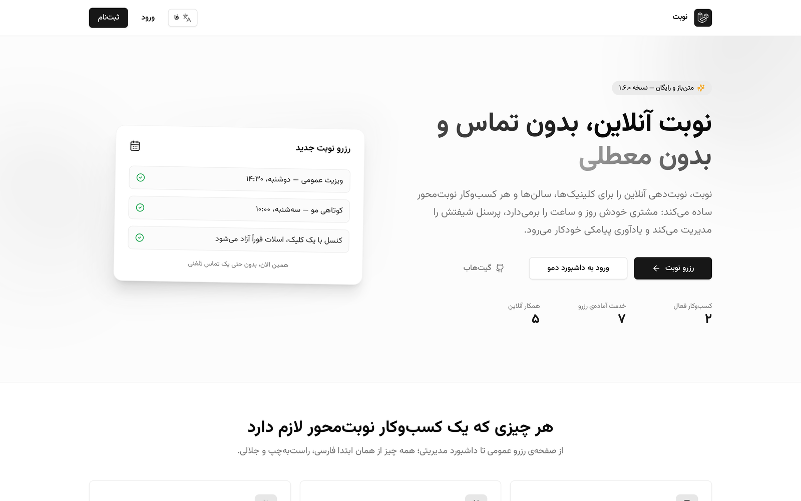 | 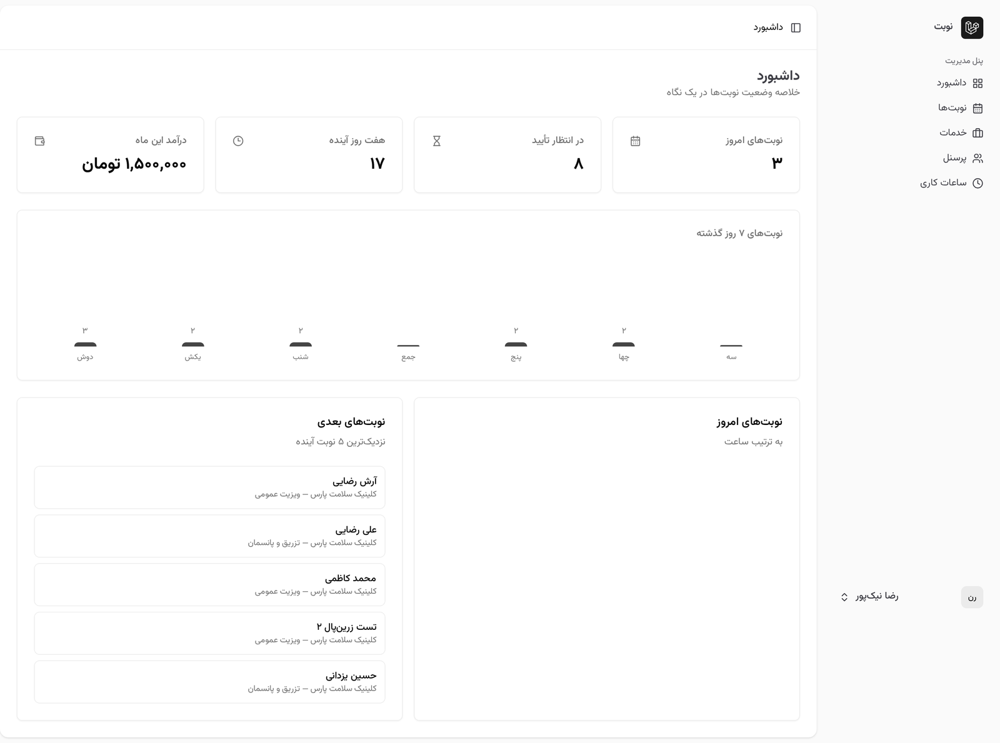 |
| **4-step booking wizard** | **ZarinPal sandbox gateway** |
| 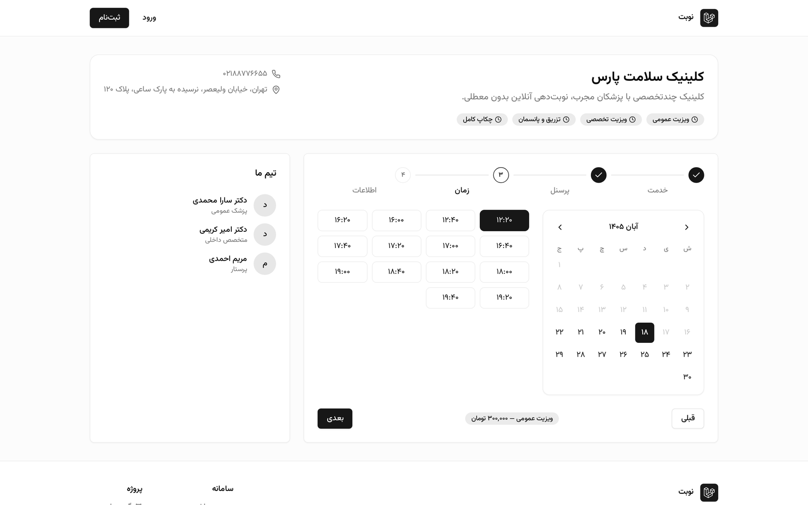 | 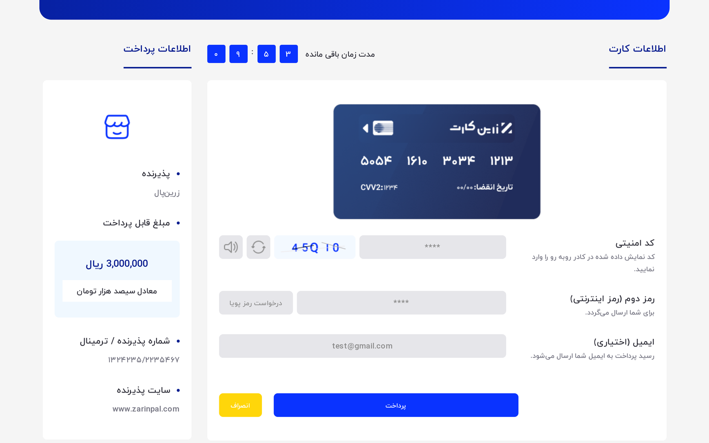 |
| **Booking confirmation + calendar export (iCal)** | **⭐ Customer ratings & reviews** |
| 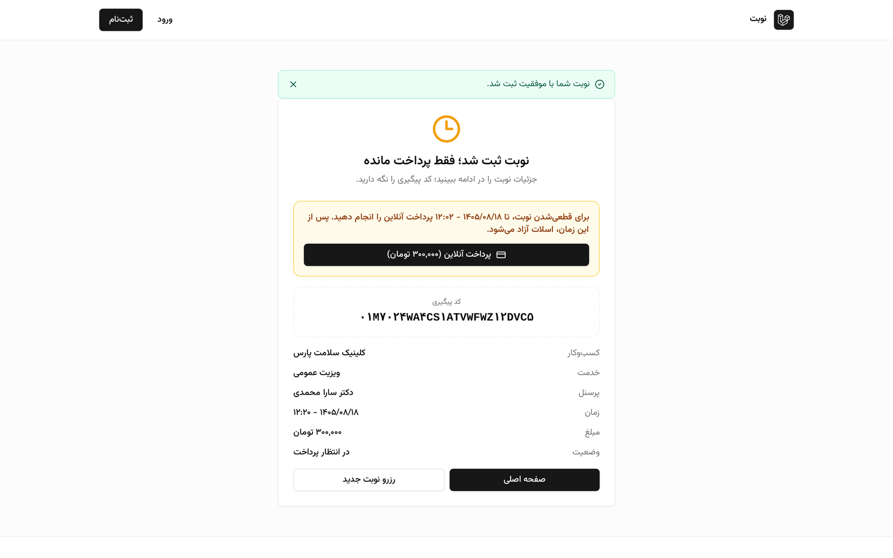 | 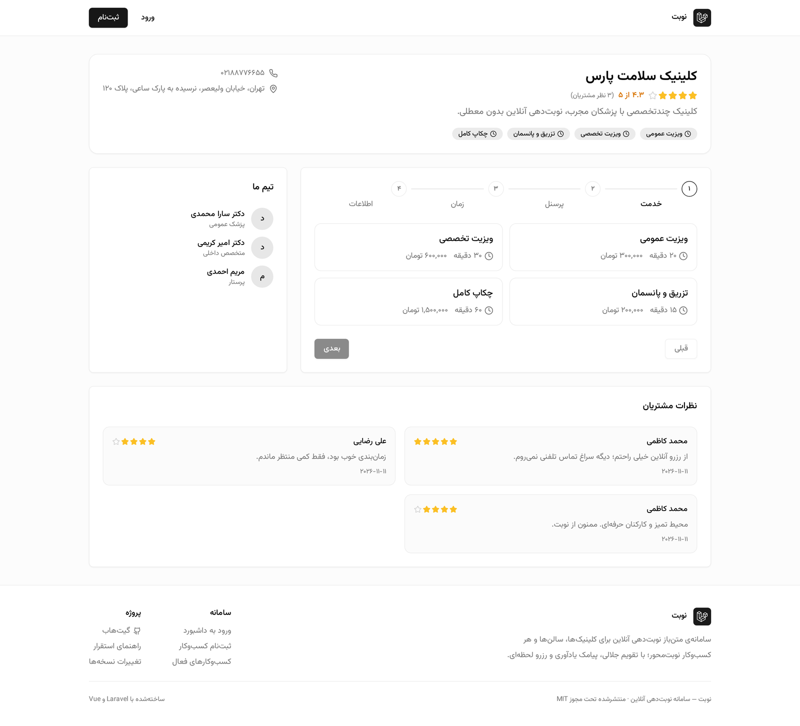 |
| **📈 Sales reports with CSV export** | **🗣️ Review moderation** |
| 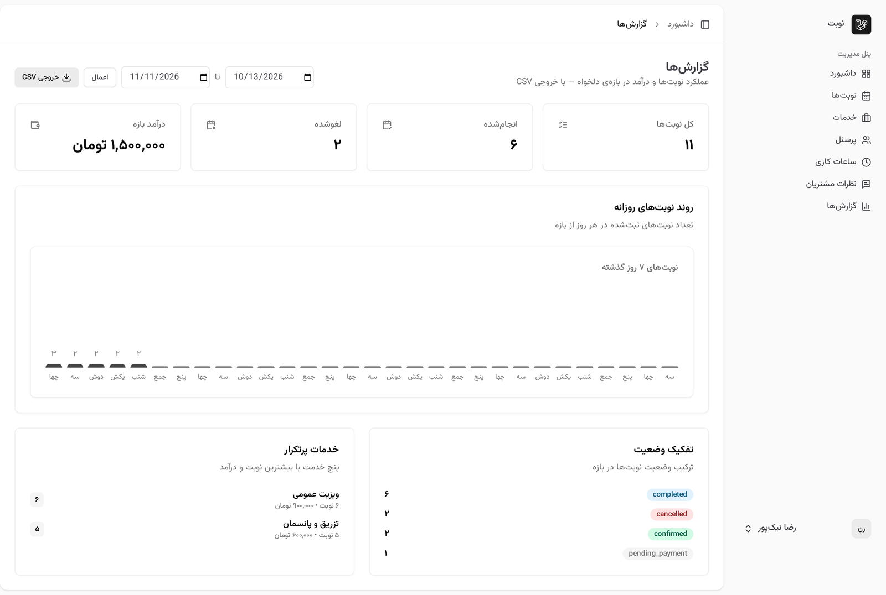 | 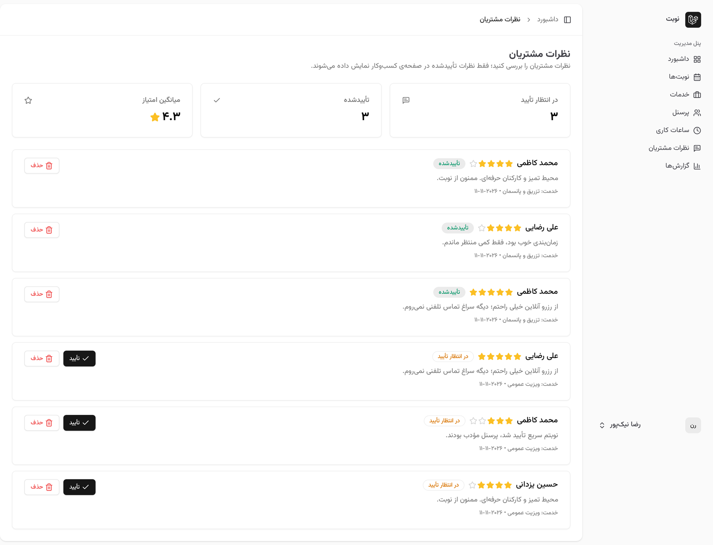 |
| **🌍 The English experience (LTR, Inter typeface)** | **🔐 Demo sign-in in English** |
| 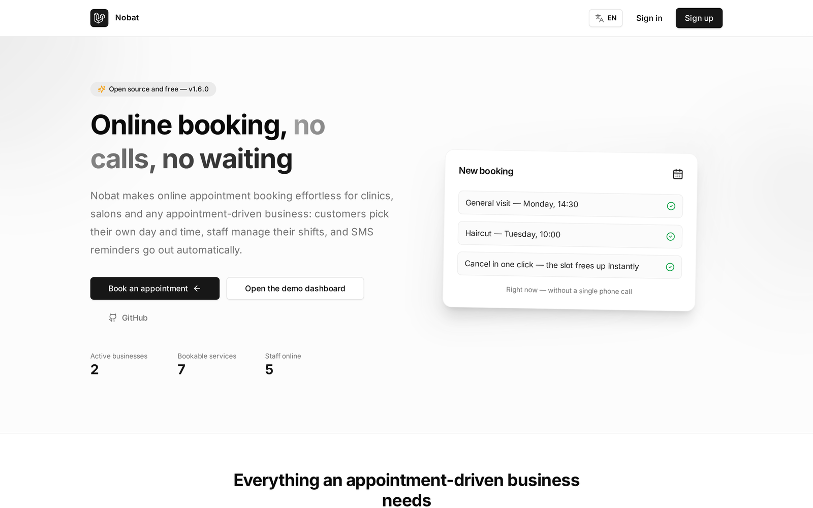 | 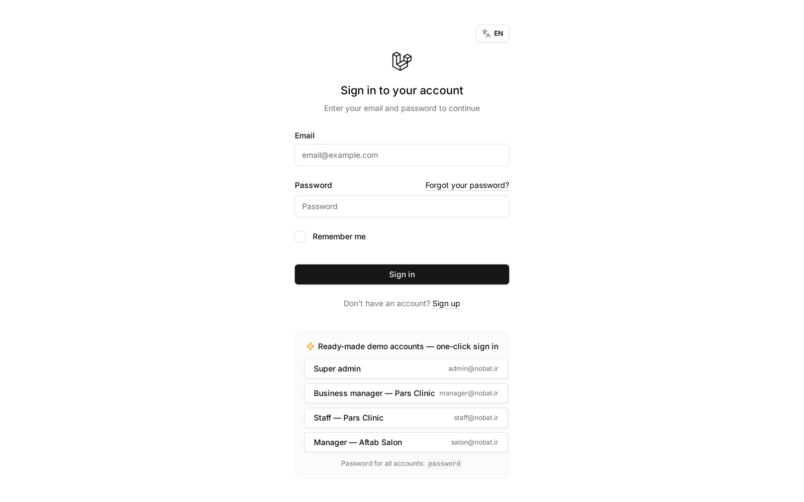 |
| **🎟️ Discount code management (v1.7.0)** | **📊 Analytics dashboard (v1.8.0)** |
| 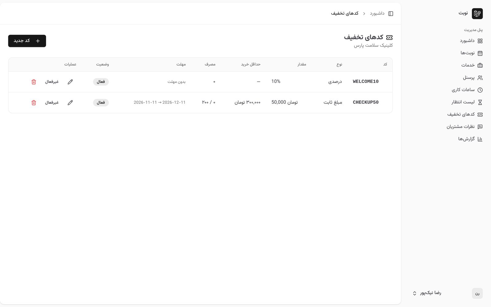 | 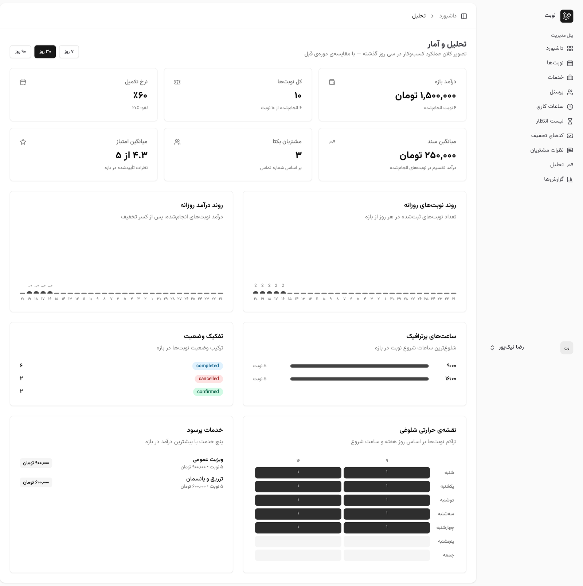 |
| **⏳ The waitlist board** | |
| 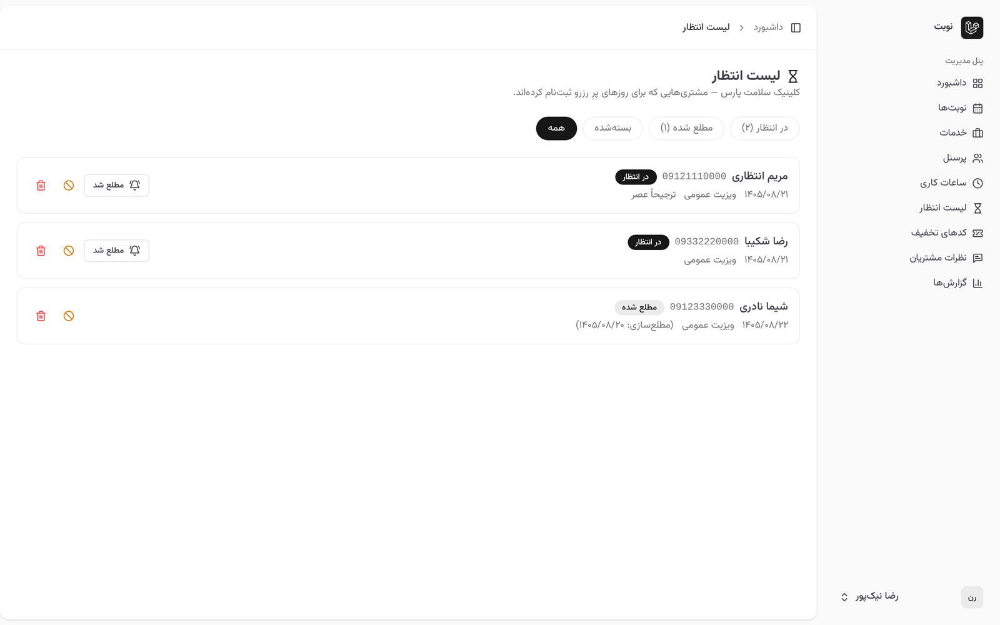 | |

---

## ✨ Features

### Customer side (no sign-up required)
- 🏢 Cached business directory
- 🧙 **4-step booking wizard**: pick a service → pick a staff member (or "anyone") → pick a day on a **Jalali calendar** → pick a free slot → leave contact info
- 🕐 Real-time slot availability combining working hours, service duration, lead time and existing bookings
- 🎫 Confirmation page with a unique tracking code (ULID)
- 💳 **Online payment (ZarinPal gateway)**: for payment-required businesses the slot stays locked until the payment deadline; printable invoice and SMS/email confirmation
- ⭐ **Ratings & reviews**: after a completed booking, the customer rates the business with stars from the tracking page; the average shows on directory cards and approved reviews on the business page
- 📆 **iCal export**: add the booking to any calendar app (Google Calendar, iOS Calendar…) with one click from the confirmation page
- 🎟️ **Discount codes**: customers enter a code in the last wizard step and it is validated live; the invoice and payment are charged with the discount applied
- ⏳ **Waitlist**: a fully booked day opens an inline waitlist form right where the empty slot grid is, so customers queue for the first freed slot
- 📱 **Installable PWA**: the web app installs on phones with a Persian/RTL manifest and custom icons
- 🌍 **Bilingual (FA/EN)**: a navbar language switcher flips the whole public experience — landing, booking wizard, confirmation and auth pages — into polished English with the Inter typeface, Latin digits and transliterated Jalali months; the choice persists in a one-year cookie
- 🛡️ Rate limiting on booking submission (10/min) and slot queries (60/min)

### Business & admin side
- 📊 Statistics dashboard: today's appointments, pending confirmations, next week, monthly revenue + a 7-day chart
- 📅 Appointment management with status/date/staff filters and a guarded status flow (pending → confirmed → done / cancelled / no-show) — final states are immutable
- 💼 CRUD for services (duration & price), staff members and working hours (morning/evening shifts)
- 🗣️ **Review moderation**: approve/delete customer reviews with average-rating stats — only approved reviews go public
- 🎟️ **Discount code management**: percent or fixed codes with a minimum purchase, total and per-customer usage caps, an activation window and one-click enable/disable
- ⏳ **Waitlist board**: per-day queue with statuses (waiting / notified / booked), a "customer reached" action and an automatic hint when a booking is cancelled
- 📈 **Sales reports**: custom date ranges with revenue, status breakdown, top services, a daily trend chart and **CSV export**
- 📑 **Excel export (v1.11.0)**: a real .xlsx file from the same report route — built by Nobat's own OOXML writer with **zero new dependencies** (a stored ZIP with per-part crc32, a right-to-left sheet and a bold header row); the «خروجی اکسل» button sits next to CSV on the reports page
- 📊 **Analytics dashboard (v1.8.0)**: KPI cards for revenue, bookings, completion/cancellation rate, average ticket, unique customers and rating — each compared against the previous period; daily booking & revenue trends over 7/30/90-day ranges, peak hours, a weekday×hour demand heatmap and top services by revenue — with **discount-aware** revenue
- 👥 **Roles**: `super-admin` (manages every business), `manager` (own business), `staff` (own schedule), `customer`
- 🔌 **Public API (v1.10.0)**: a token-based REST API under `/api/v1` — exchange email/password for a Bearer token (only its SHA-256 is stored), then read `me`, `businesses` and paginated, filterable `appointments` under the same tenancy rules as the dashboard; manage tokens from the «کلیدهای API» dashboard page and read the full reference in [`docs/API.md`](docs/API.md)

### Infrastructure
- 🔐 **Double-booking prevention** with a transaction + `lockForUpdate` on the staff row
- 📨 Queued notifications (database + SMS behind a driver architecture — log driver and a real **Kavenegar** gateway driver included)
- ⏰ **SMS reminders (v1.9.0)**: the hourly `nobat:send-reminders` command covers every confirmed appointment in the next 24 hours; "send first, stamp after" — a gateway failure is retried, a success is never repeated; switch off with `NOBAT_SMS_REMINDERS=false`
- 🧪 **142 green Pest tests**: slot logic, conflict prevention, authorization, status flow, SMS gateway, reminders, the full payment cycle, reviews, reports, analytics, the bilingual experience, discount codes, the waitlist, the public API and the customers panel
- 🛡️ **Professional hardening (v1.12.0)**: a security header set on every web and API response (nosniff, frame protection, referrer policy, permissions policy, HSTS in production), branded RTL Persian error pages for 403/404/419/500/503 with no build dependency, SEO + OpenGraph meta with a 1280x640 preview image, secure demo cookies, config/route/view boot caching on the demo and an `npm audit fix` sweep
- 🐳 Docker (nginx + php-fpm + queue worker + MySQL + Redis) and GitHub Actions CI

## 🧱 Tech stack

| Layer | Technology |
|---|---|
| Backend | Laravel 13, PHP 8.4+ |
| Frontend | Inertia 2, Vue 3, TypeScript, Tailwind CSS, shadcn-vue |
| Auth & roles | Laravel Auth + Spatie Permission |
| Testing | Pest (Feature + Domain) |
| Queue & cache | Redis (Docker) / Database |
| Calendar | Lightweight TypeScript port of jalaali-js (MIT) |

## 🚀 Quick start

Requirements: PHP 8.4+, Composer, Node 20+

```bash
git clone https://github.com/Abolfazlrwm/nobat.git
cd nobat

composer install
cp .env.example .env
php artisan key:generate

touch database/database.sqlite   # SQLite is the default database
php artisan migrate --seed       # seeds Persian demo data

npm install && npm run dev       # terminal 1
php artisan serve                # terminal 2
```

Then open `http://localhost:8000`.

### With Docker (production-like)

```bash
cp .env.docker.example .env
docker compose up -d --build
docker compose exec app php artisan key:generate
docker compose exec app php artisan migrate --seed
```

Full production deployment walkthrough, Kavenegar SMS setup and a go-live checklist: [`docs/DEPLOYMENT.md`](docs/DEPLOYMENT.md)

## 🧪 Running the tests

```bash
php artisan test     # 49 tests — in-memory SQLite
vendor/bin/pint --test
```

## 🏛️ Architecture in a nutshell

- **SlotGenerator** computes free slots from working hours (business defaults + per-staff overrides), service duration, lead time, booking horizon and existing bookings — returning the list of free staff per slot.
- **BookingService** reserves inside a single transaction: the staff row is locked with `lockForUpdate` so two concurrent requests can never grab the same slot, then the slot is re-validated against the same source of truth (SlotGenerator).
- **SMS driver contract**: `log` driver for development, **Kavenegar** driver for real traffic — switching is pure environment configuration.

Full architecture guide (in Persian): [`docs/ARCHITECTURE.md`](docs/ARCHITECTURE.md)

## 🗺️ Roadmap

- [x] **v1.0** — booking core, Jalali wizard, roles, 46 tests, CI & Docker
- [x] **v1.1** — live Render demo, RTL sidebar fix, Nobat branding
- [x] **v1.2** — one-click demo sign-in, Kavenegar SMS driver, deployment guide
- [x] **v1.4** — online payments (ZarinPal sandbox): Payment/Invoice/Refund models, idempotent callbacks, refunds, invoices and slot locking
- [x] **v1.5** — ratings & reviews with moderation, sales reports with CSV export, iCal export and an installable PWA
- [x] **v1.6** — fully bilingual (fa/en): language switcher, dynamic RTL↔LTR, Inter for English, server + client i18n
- [x] **v1.7** — discount codes (percent/fixed with usage caps and live validation) and a waitlist for fully booked days with a manager board
- [x] **v1.8** — analytics dashboard: KPIs with previous-period deltas, daily booking/revenue trends (7/30/90 days), peak hours, a weekday×hour heatmap and top services
- [x] **v1.9** — automatic SMS reminders 24 hours before the appointment: an hourly command plus a queued job with a send-once guarantee on the existing SMS driver
- [x] **v1.10** — token-based public API on `/api/v1`: issue/revoke tokens (only hashes stored), `me`, `businesses` and paginated filtered `appointments` — reference in [`docs/API.md`](docs/API.md)
- [x] **v1.11** — Excel (xlsx) export for reports: a pure-PHP OOXML writer with zero new dependencies (stored ZIP with crc32, RTL sheet, bold header) — covered by archive-integrity tests that verify every part's crc and offsets
- [x] **v1.13** — customers panel: the per-phone customer book with lifetime spend, the status split, the no-show rate and a full profile with the appointment history
- [ ] Translated dashboard panels (the public experience is already bilingual)

Have an idea? Open a [feature request](../../issues/new?template=feature_request.yml).

## 🤝 Contributing

Workflow, commit conventions and test guidelines: [`CONTRIBUTING.md`](CONTRIBUTING.md) · Vulnerability reports: [`SECURITY.md`](SECURITY.md)

## 📄 License

Released under the [MIT License](LICENSE) — © 2026 Abolfazl Ranjbaran
