<div align="center">

# نوبت — Nobat 🗓️

**سامانه نوبت‌دهی آنلاین چندکسب‌وکاری با Laravel 13 و Vue 3**

فارسی، RTL، تقویم جلالی — رزرو بدون تماس تلفنی و بدون معطلی

[](https://github.com/Abolfazlrwm/nobat/actions/workflows/ci.yml)
[](https://laravel.com)
[](https://vuejs.org)
[](https://github.com/Abolfazlrwm/nobat/actions)
[](https://render.com/deploy?repo=https://github.com/Abolfazlrwm/nobat)

</div>

<p align="center"><sub>فارسی — <a href="README.en.md">English README</a> 🌍</sub></p>

---

## 🔴 دموی زنده

**نسخه‌ی زنده:** [nobat-demo.onrender.com](https://nobat-demo.onrender.com) 🚀

پروژه با بلوپرینت Render از قبل آماده‌ی استقرار است — با دکمه‌ی بالا (یا `New + → Blueprint` در داشبورد Render) در چند دقیقه یک نسخه‌ی زنده با SQLite و داده‌های نمونه بالا می‌آید.

حساب‌های آماده‌ی دمو (رمز همه: `password`):

| نقش | ایمیل |
|---|---|
| مدیر کل سامانه | `admin@nobat.ir` |
| مدیر کسب‌وکار (کلینیک پارس) | `manager@nobat.ir` |
| پرسنل | `staff@nobat.ir` |
| مدیر (سالن آفتاب) | `salon@nobat.ir` |

> ℹ️ پلن رایگان Render بعد از ۱۵ دقیقه بی‌کاری سرویس را به خواب می‌برد؛ بازدید اول پس از آن حدود یک دقیقه طول می‌کشد و دیتابیس دمو در هر اجرا از نو ساخته می‌شود.
>
> 🎯 در صفحه‌ی ورودِ دمو، هر حساب یک دکمه‌ی «ورود با یک کلیک» دارد — لازم نیست رمزی را دستی تایپ کنید.

---

## 🖼️ نمای پروژه

| صفحه اصلی — لندینگ زنده | داشبورد مدیریت |
|:---:|:---:|
| 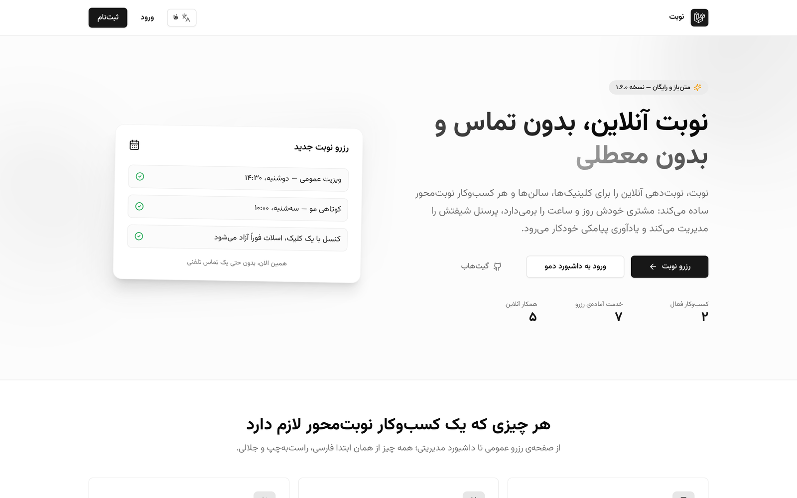 | 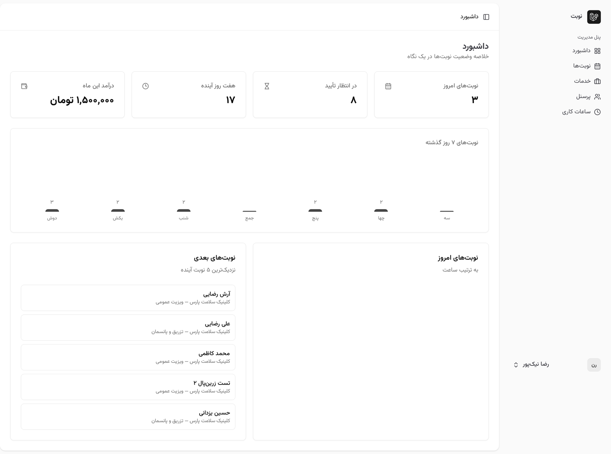 |
| **ویزارد رزرو ۴ مرحله‌ای** | **درگاه پرداخت زرین‌پال (سندباکس واقعی)** |
| 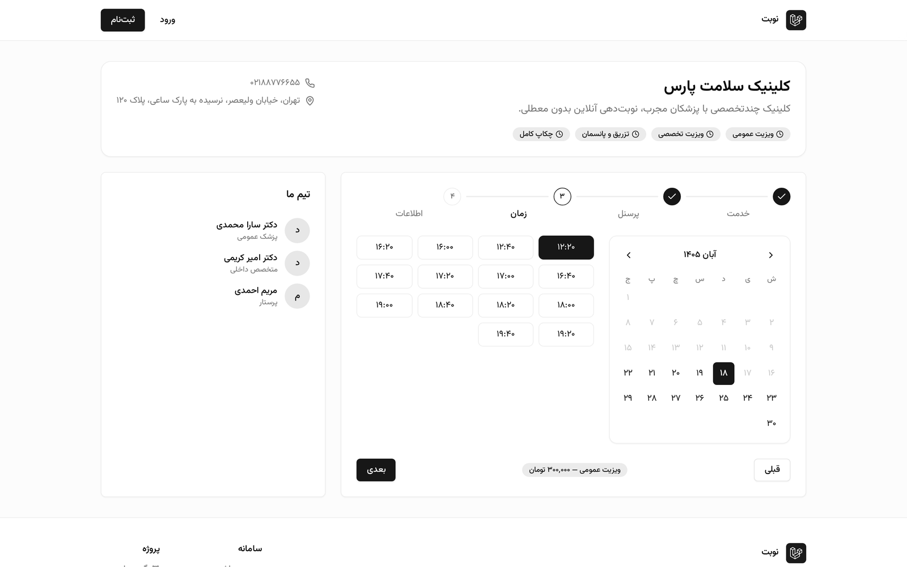 | 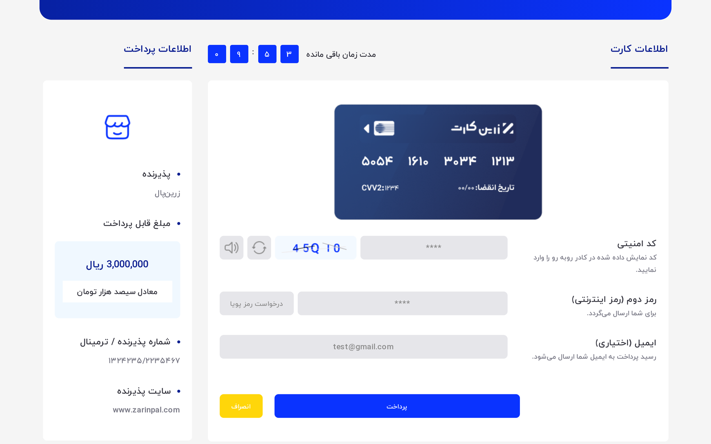 |
| **تأیید نوبت + افزودن به تقویم (iCal)** | **⭐ امتیاز و نظرات مشتریان** |
| 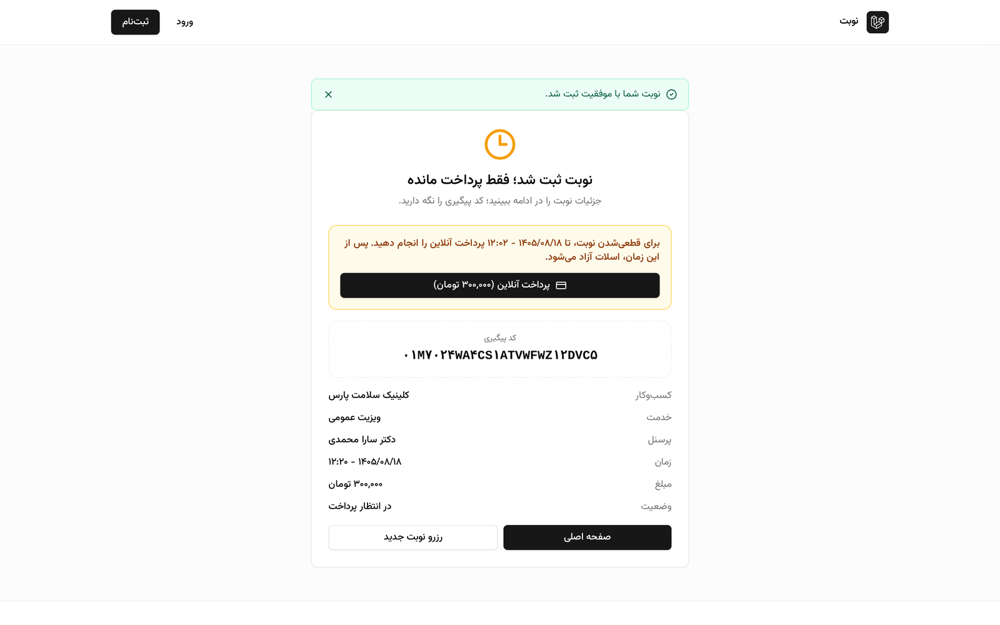 | 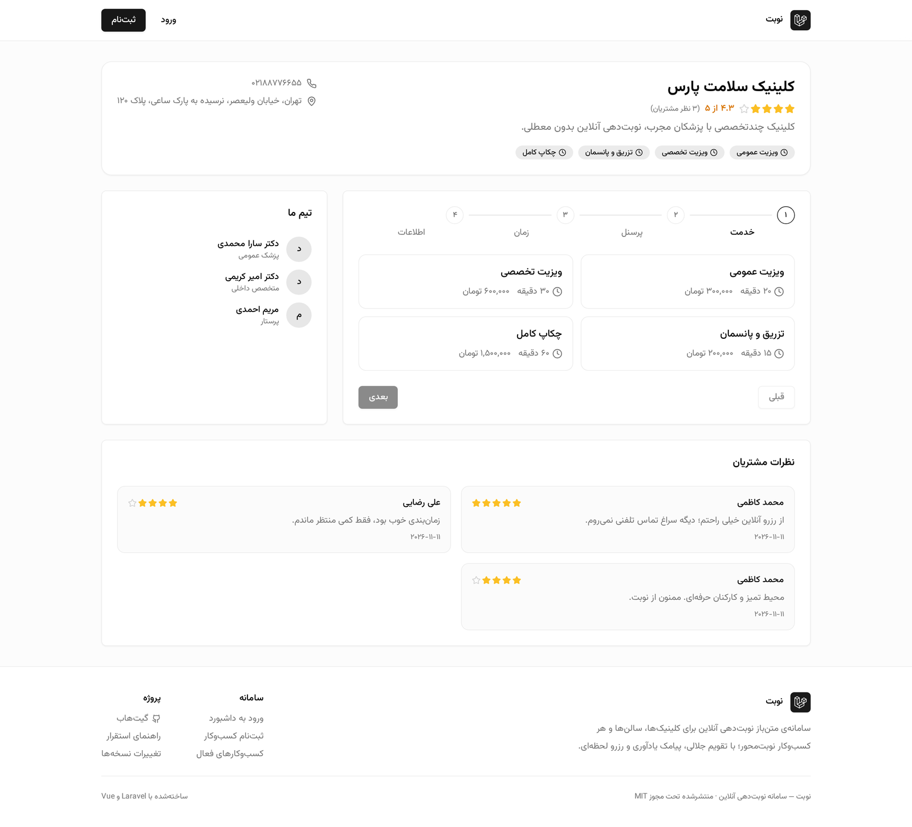 |
| **📈 گزارش‌های فروش با خروجی CSV** | **🗣️ صفحه مدیریت نظرات** |
| 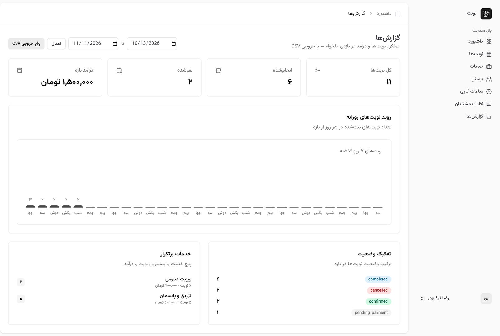 | 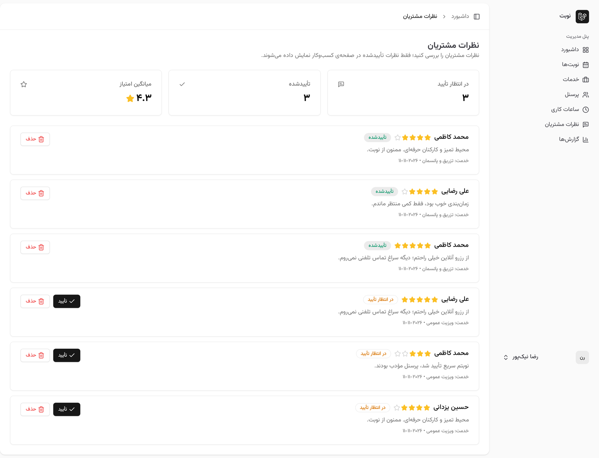 |
| **🌍 تجربه‌ی انگلیسی (LTR با فونت Inter)** | **🔐 ورود دمو به انگلیسی** |
| 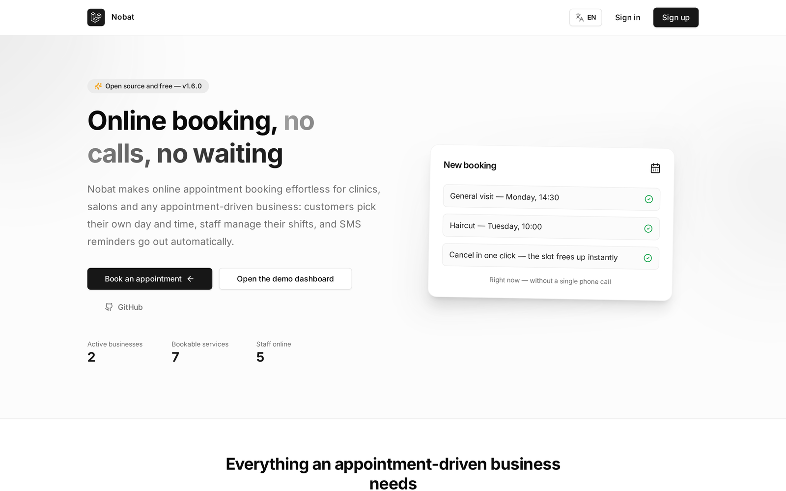 | 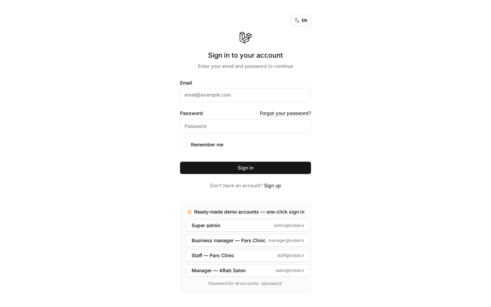 |
| **🎟️ مدیریت کدهای تخفیف (نسخه ۱.۷.۰)** | **⏳ برد لیست انتظار** |
| 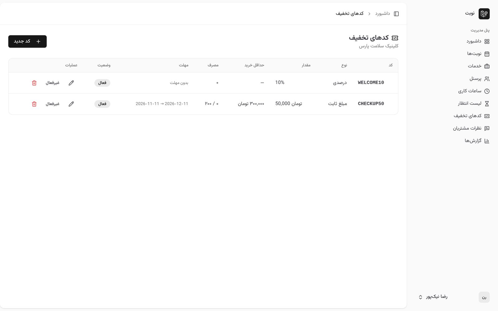 | 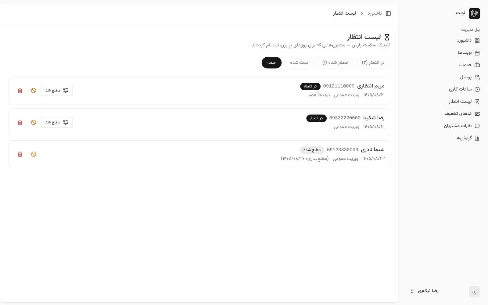 |

---

## ✨ قابلیت‌ها

### سمت مشتری (بدون نیاز به ثبت‌نام)
- 🏢 دایرکتوری کسب‌وکارها با کش
- 🧙 **ویزارد ۴ مرحله‌ای رزرو**: انتخاب خدمت ← انتخاب پرسنل (یا «فرقی نمی‌کند») ← انتخاب روز با **تقویم جلالی** ← انتخاب اسلات آزاد ← اطلاعات تماس
- 🕐 نمایش لحظه‌ای اسلات‌های آزاد با اعمال زمان‌بندی کاری، مدت خدمت، پیش‌زمان لازم و نوبت‌های قبلاً رزروشده
- 🎫 صفحه تأیید با کد پیگیری یکتا (ULID)
- 💳 **پرداخت آنلاین (درگاه زرین‌پال)**: در کسب‌وکارهای پرداخت‌محور، اسلات تا پایان مهلت پرداخت قفل می‌شود؛ فاکتور چاپی و پیامک/ایمیل تأیید
- ⭐ **امتیازدهی و نظرات**: پس از انجام نوبت، مشتری از همان صفحه‌ی کد پیگیری به کسب‌وکار ستاره می‌دهد؛ میانگین امتیاز روی کارت‌های دایرکتوری و نظرات تأییدشده در صفحه‌ی کسب‌وکار نمایش داده می‌شود
- 📆 **خروجی iCal**: افزودن نوبت به هر تقویمی (Google Calendar، تقویم iOS و…) با یک کلیک از صفحه‌ی تأیید
- 🎟️ **کد تخفیف**: مشتری در گام آخر ویزارد کد را وارد و همان‌جا اعتبارسنجی زنده می‌کند؛ مبلغ فاکتور و پرداخت با تخفیف محاسبه می‌شود
- ⏳ **لیست انتظار**: روزی که بازه‌ی خالی ندارد، فرم ثبت‌نام لیست انتظار همان‌جا باز می‌شود و مشتری برای آزادشدن اسلات صف می‌شود
- 📱 **نصب‌شدن مثل اپ (PWA)**: وب‌اپ قابل نصب روی موبایل با manifest فارسی/RTL و آیکون‌های اختصاصی
- 🌍 **دو زبانه (فارسی/انگلیسی)**: سوییچر زبان در نوبار، کل تجربه‌ی عمومی — لندینگ، ویزارد رزرو، تأیید نوبت و ورود — به انگلیسی روان با فونت Inter، اعداد لاتین و تقویم با ماه‌های transliterate‌شده؛ انتخاب زبان در کوکی یک‌ساله می‌ماند
- 🛡️ Rate limiting روی ثبت نوبت (۱۰ درخواست در دقیقه) و استعلام اسلات (۶۰ در دقیقه)

### سمت کسب‌وکار و ادمین
- 📊 داشبورد آماری: نوبت‌های امروز، در انتظار تأیید، هفته آینده، درآمد ماه + نمودار ۷ روز اخیر
- 📅 مدیریت نوبت‌ها با فیلتر وضعیت/تاریخ/پرسنل و گردش وضعیت (در انتظار ← تأیید شده ← انجام شده / لغو / عدم حضور) — وضعیت‌های نهایی قابل تغییر نیستند
- 💼 CRUD خدمات (مدت زمان و قیمت)، پرسنل و ساعات کاری (شیفت‌های صبح/عصر)
- 🗣️ **مدیریت نظرات مشتریان**: صف تأیید/حذف نظرات با آمار میانگین امتیاز — فقط نظرات تأییدشده عمومی می‌شوند
- 🎟️ **مدیریت کدهای تخفیف**: ساخت کد درصدی/مبلغ ثابت با حداقل خرید، سقف مصرف کل و هر مشتری، بازه‌ی اعتبار و فعال/غیرفعال‌سازی از پنل
- ⏳ **برد لیست انتظار**: صف مشتری‌های هر روز با وضعیت (در انتظار/مطلع‌شده/نوبت گرفت)، علامت‌گذاری «مطلع شد» و هشدار خودکار هنگام لغو نوبت
- 📈 **گزارش‌های فروش**: بازه‌ی تاریخ دلخواه با درآمد، تفکیک وضعیت، خدمات پرتکرار، نمودار روزانه و **خروجی CSV**
- 👥 **نقش‌ها**: `super-admin` (مدیریت همه کسب‌وکارها)، `manager` (کسب‌وکار خودش)، `staff` (برنامه خودش)، `customer`

### زیرساخت
- 🔐 جلوگیری از **رزرو همزمان** با تراکنش + `lockForUpdate` روی رکورد پرسنل
- 💳 **چرخه‌ی کامل پرداخت** با معماری درایور: قرارداد `PaymentGateway`، درگاه زرین‌پال (sandbox) و درگاه تستِ فوری؛ idempotency سه‌لایه که وب‌هوک تکراری هرگز دو بار پرداخت ثبت نمی‌کند، رفاند خودکار و آزادسازی اسلات‌های منقضی با Scheduler
- 🌐 **چندزبانه‌ی واقعی (سرور + کلاینت)**: middleware `SetLocale` و `POST /locale` مترجم لاراول را رانند (پیام‌های flash و خطاهای اسلات از `lang/{fa,en}.json`) و vue-i18n 11 با کاتالوگ‌های تایپ‌شده در فرانت؛ تست‌های sync از واگرایی دو کاتالوگ جلوگیری می‌کنند
- 📨 نوتیفیکیشن صف‌بندی‌شده (Database + SMS با معماری درایور — درایور لاگ و درگاه کاوه‌نگار آماده‌اند)
- 🧪 **۱۰۸ تست Pest** سبز: منطق اسلات، جلوگیری از تداخل، مجوزها، گردش وضعیت، درگاه پیامک، چرخه‌ی کامل پرداخت، نظرات، گزارش‌ها، چندزبانه، تخفیف و لیست انتظار
- 🐳 Docker (nginx + php-fpm + worker + MySQL + Redis) و GitHub Actions CI

## 🧱 استک فناوری

| لایه | فناوری |
|---|---|
| بک‌اند | Laravel 13, PHP 8.4+ |
| فرانت‌اند | Inertia 2, Vue 3, TypeScript, Tailwind CSS, shadcn-vue |
| احراز هویت و نقش‌ها | Laravel Auth + Spatie Permission |
| تست | Pest (Feature + Domain) |
| صف و کش | Redis (در Docker) / Database |
| تقویم | پورت سبک‌وزن jalaali-js (MIT) با TypeScript |

## 🚀 راه‌اندازی سریع

پیش‌نیاز: PHP 8.4+, Composer, Node 20+

```bash
git clone https://github.com/Abolfazlrwm/nobat.git
cd nobat

composer install
cp .env.example .env
php artisan key:generate

touch database/database.sqlite   # دیتابیس پیش‌فرض SQLite است
php artisan migrate --seed       # داده‌های دمو فارسی ساخته می‌شوند

npm install && npm run dev       # ترمینال اول
php artisan serve                # ترمینال دوم
```

سپس `http://localhost:8000` را باز کنید.

### با Docker (محیط شبیه production)

```bash
cp .env.docker.example .env
docker compose up -d --build
docker compose exec app php artisan key:generate
docker compose exec app php artisan migrate --seed
```

مراحل کامل استقرار production، تنظیم درگاه پیامک کاوه‌نگار و چک‌لیست go-live: [`docs/DEPLOYMENT.md`](docs/DEPLOYMENT.md)

### 👤 حساب‌های دمو (پسورد همه: `password`)

| نقش | ایمیل |
|---|---|
| مدیر سامانه | `admin@nobat.ir` |
| مدیر کلینیک | `manager@nobat.ir` |
| پرسنل کلینیک | `staff@nobat.ir` |
| مدیر سالن | `salon@nobat.ir` |

## 🧪 اجرای تست‌ها

```bash
php artisan test     # ۱۰۸ تست — SQLite درون‌حافظه‌ای
vendor/bin/pint --test
```

## 🏛️ معماری در یک نگاه

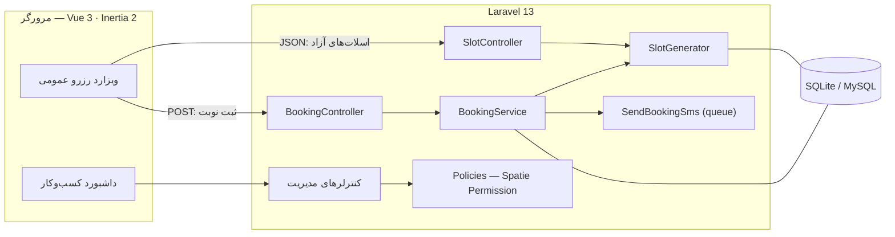

- **SlotGenerator**: اسلات‌های آزاد را از ترکیب ساعات کاری (پیش‌فرض کسب‌وکار + ساعات اختصاصی پرسنل)، مدت خدمت، پیش‌زمان لازم، افق رزرو و نوبت‌های اشغال‌شده محاسبه می‌کند و برای هر اسلات لیست پرسنل آزاد را برمی‌گرداند.
- **BookingService**: رزرو در یک تراکنش؛ ابتدا رکورد پرسنل با `lockForUpdate` قفل می‌شود تا دو درخواست همزمان هرگز نتوانند یک اسلات را رزرو کنند؛ سپس معتبر بودن اسلات با همان منبع حقیقت (SlotGenerator) بازبینی می‌شود.
- **SMS Driver**: `SmsDriver` یک قرارداد است؛ درایور `log` برای توسعه و **درایور کاوه‌نگار** برای ارسال واقعی آماده‌اند — فعال‌سازی فقط با متغیرهای محیطی.

مستند کامل معماری: [`docs/ARCHITECTURE.md`](docs/ARCHITECTURE.md)

## 💳 جریان پرداخت آنلاین (زرین‌پال — sandbox)

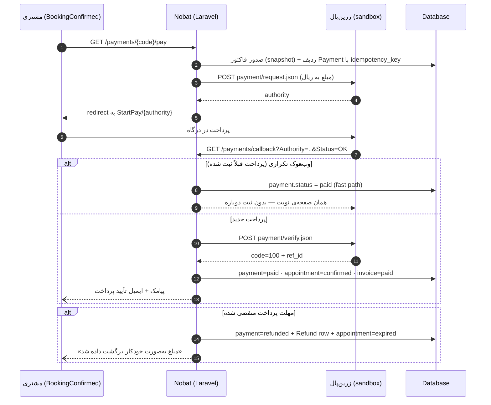

**idempotency سه‌لایه:** (۱) ایندکس UNIQUE روی `authority`، (۲) قفل cache اتمی per-payment، (۳) بازبینی وضعیتِ نهایی داخل تراکنش — پس تکرار وب‌هوک هرگز دو ردیف پرداخت نمی‌سازد.

**درایورها:** `NOBAT_PAYMENT_DRIVER=zarinpal` (sandbox با `ZARINPAL_SANDBOX=true`) برای محیط واقعی؛ `log` برای توسعه و تست بدون شبکه.

## 🗺️ نقشه راه

- [x] **v1.0** — هسته رزرو، ویزارد جلالی، نقش‌ها، ۴۶ تست، CI و Docker
- [x] **v1.1** — استقرار دمو روی Render، سایدبار RTL و برندینگ نوبت
- [x] **v1.2** — ورود یک‌کلیکی حساب‌های دمو، درگاه پیامک کاوه‌نگار، راهنمای استقرار
- [x] **v1.3** — لندینگ‌پیج بازطراحی‌شده با هیروی زنده و پنل دمو
- [x] **v1.4** — پرداخت آنلاین زرین‌پال (sandbox): مدل Payment/Invoice/Refund، callback با idempotency، رفاند، فاکتور و قفل اسلات تا پایان مهلت پرداخت
- [ ] یادآوری پیامکی قبل از نوبت (Scheduler + Database queue در production)
- [ ] گزارش‌های پیشرفته و خروجی Excel
- [x] **v1.6** — دو زبانه‌ی کامل (fa/en): سوییچر زبان، RTL↔LTR داینامیک، فونت Inter برای انگلیسی، i18n سمت سرور و کلاینت
- [x] **v1.7** — کد تخفیف (درصدی/ثابت با سقف مصرف و اعتبارسنجی زنده) و لیست انتظار روزهای پر با برد مدیریتی
- [ ] یادداشت: PWA در v1.5 منتشر شد

ایده‌ی جدیدی دارید؟ یک [پیشنهاد فیچر](../../issues/new?template=feature_request.yml) باز کنید.

## 🤝 مشارکت

راهنمای کامل گردش کار، قرارداد کامیت‌ها و اجرای تست‌ها: [`CONTRIBUTING.md`](CONTRIBUTING.md) · گزارش آسیب‌پذیری: [`SECURITY.md`](SECURITY.md)

## 📄 لایسنس

انتشار تحت [لایسنس MIT](LICENSE) — © ۲۰۲۶ Abolfazl Ranjbaran
